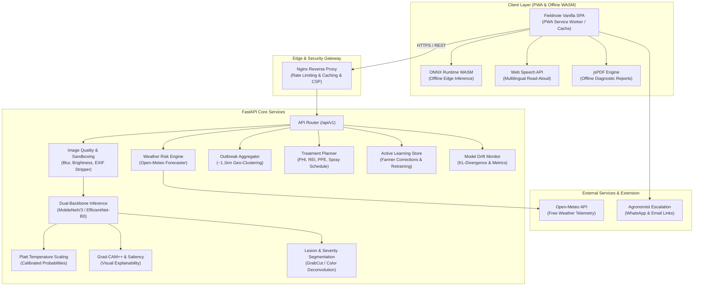

# Fieldnote — Farmer-First Crop Health Platform

[](https://github.com/fieldnote/crop-health-app/actions/workflows/ci.yml)
[](CHANGELOG.md)
[](https://www.python.org/)
[](LICENSE)
[](backend/tests)

**Fieldnote** is a production-grade, offline-capable, farmer-first diagnostic and decision-support platform for foliar crop diseases in smallholder agriculture. It pairs calibrated deep-learning vision models with agronomic treatment planning, weather-driven blight risk forecasting, anonymous community disease tracking, and local language voice accessibility.

---

## Architecture Overview



---

## 10 Core Enterprise Features

1. **Progressive Web App (PWA) & Offline Shell**:
   - Installable on mobile devices with zero store overhead.
   - Offline-first cache for static assets, plant knowledge base, and previously saved diagnostic reports.
   - On-device inference fallback via ONNX Runtime Web / TFLite WASM when internet connectivity is unavailable.

2. **Multilingual Support & Voice Read-Aloud**:
   - Complete localized translations across UI, symptom guides, and treatment steps for:
     - **English (`en`)**
     - **Swahili / Kiswahili (`sw`)**
     - **Hindi / हिन्दी (`hi`)**
     - **Tamil / தமிழ் (`ta`)**
   - In-app text-to-speech voice read-aloud via the Web Speech API tailored to farmers in noisy field conditions.

3. **Multi-Leaf Batch Scanning**:
   - Capture up to 5 leaves across different canopy heights of a single plant.
   - Aggregated plant-level verdict using majority voting and confidence-weighted distributions.
   - Thumbnail gallery with individual leaf disease confidence and quality scores.

4. **Weather-Aware Blight Risk Forecasting**:
   - Real-time weather integration via the Open-Meteo API (zero API key required).
   - Computes relative humidity and temperature-based sporulation risk scores for late blight and early blight.

5. **Community Outbreak Map & Early Warning**:
   - Opt-in anonymous disease reporting with automatic GPS coordinate rounding to 2 decimal places ($\approx 1.1\text{ km}$ precision) to protect grower privacy.
   - Interactive Leaflet heatmap displaying regional disease clusters and county-level outbreak density.

6. **Actionable Treatment Planner & Safety Reminders**:
   - Integrated chemical, biological, and cultural intervention schedules.
   - Clear Pre-Harvest Intervals (PHI) and Re-Entry Intervals (REI) with countdown timers.
   - Personal Protective Equipment (PPE) checklists and estimated treatment costs per acre.

7. **Active-Learning Feedback Loop**:
   - In-app farmer confirmation and correction submission with optional photo sharing consent for model retraining.
   - Admin review dashboard (`#/admin/feedback`) for agronomists to audit user feedback and validate edge cases.

8. **Exportable PDF Field Diagnostic Reports**:
   - 100% client-side PDF generation via jsPDF.
   - Includes original leaf photo, Grad-CAM++ saliency map, severity metrics, and localized treatment instructions.

9. **Direct Agronomist & Extension Escalation**:
   - Pre-formatted one-tap WhatsApp deep-links and Email escalations containing diagnosis summaries and severity metrics.

10. **Model Drift & Production Analytics Dashboard**:
    - Real-time monitoring of scan volumes, disease distribution shifts, average confidence scores, and blurry image rates.
    - Automated KL-divergence drift alerts accessible at `#/admin/analytics`.

---

## Quickstart

### Option A: Running with Docker Compose (Recommended)
```bash
# Clone the repository
git clone https://github.com/fieldnote/crop-health-app.git
cd crop-health-app

# Launch API and Nginx reverse proxy
docker-compose up --build
```
Access the application at:
- **Web App:** [http://localhost](http://localhost)
- **Direct API:** [http://localhost:8000](http://localhost:8000)
- **API Swagger Documentation:** [http://localhost:8000/docs](http://localhost:8000/docs)

---

### Option B: Local Python Development
```bash
# Set up Python virtual environment
python -m venv venv
# On Windows:
.\venv\Scripts\Activate.ps1
# On Linux/macOS:
source venv/bin/activate

# Install package dependencies
pip install -e .
pip install pytest pytest-asyncio pytest-cov httpx ruff black mypy

# Start development server
uvicorn backend.app.main:app --reload --port 8000
```

---

## Testing & Quality Assurance

Fieldnote maintains strict code quality and test coverage requirements:

```bash
# Run backend unit and contract tests with coverage gate (>=80%)
pytest --cov=backend --cov-report=term-missing --cov-fail-under=80 backend/tests

# Run the strict model regression gate (fails if field macro-F1 drops > 1 point)
pytest backend/tests/test_model_regression.py -v

# Run Python linting and formatting
ruff check backend scripts
black --check backend scripts

# Run Frontend linting and formatting
cd frontend
npm install
npm run lint
npm run format:check

# Run Playwright End-to-End browser tests
npx playwright test
```

---

## Security & Privacy Compliance

- **OWASP Top 10 Compliant**: Strict CSP headers, `X-Frame-Options: DENY`, `X-Content-Type-Options: nosniff`, and rate-limiting. Detailed audit in [docs/security/OWASP_CHECKLIST.md](docs/security/OWASP_CHECKLIST.md).
- **Upload Sandboxing**: Pillow decompression bomb limits (`MAX_IMAGE_PIXELS = 16,000,000`), magic byte verification, and automatic EXIF GPS stripping.
- **Privacy-by-Default**: Zero PII collected or logged; community outbreak coordinates are rounded to ~1.1 km.

---

## Documentation Links

- [Model Card (Training, Metrics, Limitations)](MODEL_CARD.md)
- [REST API Specification](docs/api.md)
- [OWASP Security Checklist](docs/security/OWASP_CHECKLIST.md)
- [Contributing Guidelines](CONTRIBUTING.md)
- [Changelog](CHANGELOG.md)

---

## License

This project is licensed under the Apache 2.0 License. See [LICENSE](LICENSE) for details.
